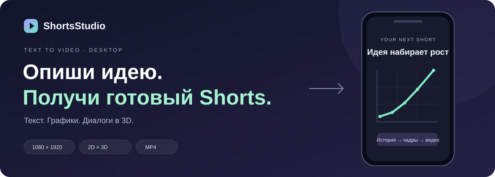
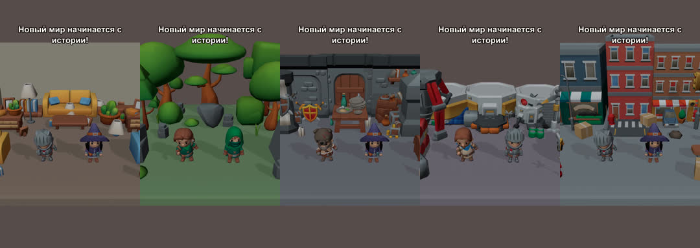

<p align="center">
  
</p>

<p align="center">
  <strong>История словами → сценарий → вертикальное видео.</strong><br>
  Настольное приложение для коротких объяснений, наглядных графиков и диалогов в 3D.
</p>

<p align="center">
  <a href="#посмотреть-результат">Демо</a> ·
  <a href="#быстрый-старт">Быстрый старт</a> ·
  <a href="#как-запустить-3d">Запуск 3D</a> ·
  <a href="docs/README.md">Документация</a>
</p>

## Ты придумываешь историю. ShortsStudio собирает ролик.

Напиши, что показать, и нажми **«Создать ролик»** — больше ничего не нужно.
2D или 3D, сцены, стиль, окружение и героев Claude выберет по описанию; ручной выбор режима
и настройки озвучки, музыки и 3D спрятаны в **«Дополнительно»**.
Приложение покажет прогресс и откроет готовое видео в превью.

| | 2D · объясняй наглядно | 3D · рассказывай через диалог |
|---|---|---|
| В кадре | Текст, твои изображения и графики | Пять миров KayKit, мультяшные ведущие, субтитры и плоские вставки |
| Подходит для | Фактов, учебных карточек, историй с цифрами | Коротких объяснений и разговоров двух персонажей |
| На выходе | MP4 · 1080 × 1920 · **60 fps** | MP4 · 1080 × 1920 · **30 fps** |
| Рендер | Pillow + FFmpeg | Blender Workbench + FFmpeg |

### Попробуй такую историю

> Сделай ролик на 10 секунд. Первые 3 секунды — заголовок «Продажи растут».
> Затем 5 секунд показывай график: январь — 10, февраль — 20, март — 35.
> В конце 2 секунды — надпись «Рост в 3,5 раза».

Историю вводят обычным текстом. Для картинки укажи путь к существующему файлу;
для графика — числа. JSON-сценарий приложение составит само.

## Посмотреть результат



**[Открыть 3D-демо всех пяти окружений →](docs/media/kaykit-showcase.mp4)**

Слева направо: комната, лес, подземелье, космобаза и город. В каждом новом мире —
10 крупных объектов и 20 деталей, одинаковая площадка и камеры. В демо показаны
четыре пары персонажей KayKit; ролик отрендерен локально в Blender без озвучки.

**[Открыть 2D-пример: «Как растёт квадрат числа?» →](docs/media/example-2d.mp4)**

Шесть секунд настоящего рендера: заголовок, график и финальная карточка.
Видео без звука; создано движком приложения из JSON-сценария.

Можно собрать своё короткое 2D-демо без API-ключа и сетевых запросов:

```powershell
.\.venv\Scripts\python.exe scripts/demo.py --duration 3 --out outputs/demo.mp4
```

## Быстрый старт

Нужны **Python 3.11**, **FFmpeg с ffprobe** в PATH и ключ Claude для генерации сценария.
Для 3D дополнительно установи [Blender](https://www.blender.org/download/) **4.2+**.

В PowerShell из папки репозитория:

```powershell
py -3.11 -m venv .venv
.\.venv\Scripts\python.exe -m pip install -r requirements.txt
ffmpeg -version
ffprobe -version
$env:DEEPSEEK_API_KEY = "<твой API-ключ DeepSeek>"
.\.venv\Scripts\python.exe -m src.ui.main
```

Если Python установлен через uv, первую команду можно заменить на
`uv venv --python 3.11 .venv`. Для Linux/macOS — [полная инструкция](docs/README.md#установка).

## Как запустить 3D

1. Установи Blender. Если его нет в PATH, укажи путь к `blender.exe` в том же PowerShell:

   ```powershell
   # Подставь путь к установленной у тебя версии.
   $env:WIBECODE_BLENDER = "C:\Program Files\Blender Foundation\Blender 5.2\blender.exe"
   & $env:WIBECODE_BLENDER --version
   .\.venv\Scripts\python.exe -m src.ui.main
   ```

2. Введи описание: слов «3D-ролик» достаточно, режим выбирать не нужно.
   Окружение и пару персонажей тоже назови в описании: комнату, лес, подземелье,
   космическую базу или город; рыцаря и мага, двух разбойников, варвара и мага
   или лучника и рыцаря. Например:

   > Сделай 3D-ролик на 6 секунд. Первые 3 секунды первый ведущий крупным планом говорит:
   > «Почему квадрат числа растёт так быстро?» Затем второй ведущий средним планом отвечает:
   > «Потому что мы умножаем число само на себя!»

3. Нажми **«Создать ролик»**. Готовое видео появится в превью; кнопка **«Показать в папке»** покажет файл MP4.

Blender запускается в фоне; открывать его окно и моделировать сцену вручную не нужно.
Пять окружений собраны из настоящих моделей **KayKit** с сопоставимой детализацией.
Есть три плана камеры; исходная студия с роботом и девушкой также сохранена.
Реплики показываются субтитрами, озвучку можно добавить через ElevenLabs или Chatterbox.
3D требует больше времени, чем 2D.

**Окружение, персонажи, голос и музыка работают вместе.** Для ручного выбора открой
«Дополнительно»: в режиме **3D** доступны окружение и пара KayKit. Там же выбери
провайдера в списке «Озвучка» и трек в списке «Музыка»: приложение сначала
добавит реплики, затем подложит музыку и приглушит её во время речи.
«Авто» выбирает один из семи встроенных инструментальных треков под настроение истории;
также можно выбрать свой аудиофайл.

Попробуй локальное 3D-демо без API-ключа:

```powershell
.\.venv\Scripts\python.exe scripts/demo_kaykit.py --environment forest --cast knight_mage --duration 4 --out outputs/kaykit.mp4
```

Для версии с голосом и своим треком добавь `--voice elevenlabs --music "C:\Music\track.mp3"`
(нужен `ELEVENLABS_API_KEY`) или выбери `--voice chatterbox`, если локальная модель установлена.

**[Как устроен 3D-движок и как отрендерить сцену без LLM →](docs/3d.md)**

## Опубликовать на YouTube

После рендера нажми **«Опубликовать на YouTube»**: ролик загрузится на твой канал как Short,
ссылка откроется в браузере. Один раз нужно скачать OAuth-клиент из Google Cloud и положить его
в `~/.shortsstudio/client_secret.json`. Пока проект не прошёл аудит Google, ролики загружаются
приватными, около 6 в день.

**[Пошаговая настройка YouTube →](docs/README.md#публикация-на-youtube)**

## Что происходит внутри

**Описание → Claude → JSON → проверка сценария → рендер → MP4.**

Claude выбирает сцены и их длительность. Кадры рисует локальный движок:
Pillow для 2D, Blender для 3D. FFmpeg собирает видео; в интерфейсе есть прогресс и отмена.

Подробнее: [JSON и публичный API](docs/README.md#формат-сценария) ·
[сборка приложения](docs/README.md#сборка) · [структура проекта](docs/README.md#структура).
